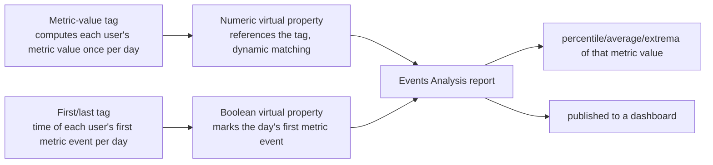

# Metric Value Statistics Aggregated by User

## Applicable Scenarios

Scenarios where you first aggregate a metric value per user (or other analysis subject), then run statistics over that metric value:

- The **75th percentile** of each user's daily usage duration, and the average of that percentile over the past 7 days
- The **average / maximum / minimum / median / variance / standard deviation** of each user's daily payment amount
- The **sum / distinct count / average per user** of a numeric property per user per day

**Hard constraint: this method is implemented via the tag model + virtual event properties. DO NOT compute everything in one shot with pure SQL (SQL breaks daily dynamic matching and historical version semantics).**

## Supported Aggregation Calibers (metric tag)

Values for `definition_request.metric.aggregation` in Step 1:

| Caliber | semantic key | Requires `property` |
|---|---|---|
| Total Count | `count` | No (pure event counting) |
| Active Days | `active_days` | No |
| Sum | `sum` | Yes |
| Average | `avg` | Yes |
| Maximum | `max` | Yes |
| Minimum | `min` | Yes |
| Median | `median` | Yes |
| Percentile | `percentile` | Yes + `percentile`; only 5/10/20/25/30/40/60/70/75/80/90/95/99 are supported |

Key points:

- Except for percentile, all calibers above share the same implementation chain — just swap `aggregation` (and `percentile` when needed); all subsequent steps are identical.
- `metric.time_range` is mandatory (enforced by the backend; the error is `recentDay or (startTime and endTime)`).
- Calibers that take a `property` require the property to be **numeric**.
- **The tag side and the report side are two separate aggregation enums**: `variance`/`stddev`/`distinct_count`/`avg_per_user`/`user_count`/`per_user_count` etc. are aggregations of the Events Analysis report (Step 4) — they run cross-user statistics over the Step 3 virtual property and **cannot** be used as Step 1 tag calibers; likewise, the tag-side semantic key for "Total Count" is `count` (not the report-side `total_count`).
- **Creation success ≠ valid caliber**: the backend performs no strict enum validation on `metric.aggregation`; an invalid key does **not** error at the `create`/`--validate` stage — it only fails at computation time (the `debug_msg` from `analysis user-tag get` reports `unknown analysisTypeValue: <key>`). Therefore, after creation you **must** check the computation status with `analysis user-tag get` to confirm the backend accepted the caliber; do not rely solely on whether create succeeded.

## Core Idea (why two tags + two virtual properties are needed)



1. **Metric-value tag**: computes each user's metric value per day (e.g., "the 75th percentile of each user's online duration from logout events today").
2. **Numeric virtual event property (referencing the tag)**: injects the tag value onto every event using `ta_tag."<tag_name>"`; `--tag-date-policies` must use "dynamic matching" (`AUTO`) so each analysis date picks the tag version from that same date.
3. **First/last tag**: finds the time (datetime type) when each user "first" completed the metric event each day; by default it uses the same event as the Step 1 metric-value tag.
4. **Boolean virtual event property (dedup)**: `#event_time = first/last tag time`, marking the user's first metric event of the day. The first/last tag value is datetime, and the `relative_event_time` operator in Events Analysis does not apply; always use this boolean property with `is_true` so each user's daily aggregated value is **counted exactly once**, otherwise results are weighted by event count.
5. **Events Analysis report**: the report metric event = the metric-value tag's event (same as Step 1 by default); apply the target aggregation to the numeric virtual property; filter on the boolean virtual property `is_true`; the report is finally published to a dashboard.

> **Trigger event defaults to the metric event**: the dedup anchor (the first/last tag's event) and the report metric event both default to the same event as the Step 1 metric-value tag (e.g., if the metric is logout duration, the first/last tag uses the first logout time and the report metric event is also logout), ensuring the metric value and the dedup anchor cover the same set of users with dates fully aligned. **Only when the user explicitly asks to include users who did not trigger the metric event (deduplicating on the active-user caliber)** should you switch to an activity event (login/launch) as the first/last tag event and the report metric event.

## Prerequisite Information Collection (only ask questions users can understand; use defaults for technical details)

**Questioning principle**: only confirm "business-level" information with the user (which event/property, which caliber, over what period), phrased in plain language. **Do not ask users about technical implementation details (trigger event, tag time range/granularity)** — ordinary users won't understand them; just apply the defaults.

| Item | Value rule | Example |
|---|---|---|
| project_id | Currently selected project; no need to ask | Project 9 |
| Metric event + numeric property | If unspecified, let the user choose via AskUserQuestion | Logout event + online duration property |
| Aggregation | If unspecified, let the user choose via AskUserQuestion (percentile requires a P value) | `percentile` + 75 |
| Summary window | If unspecified, let the user choose via AskUserQuestion | Past 7 days |
| Trigger event | **Do not ask**; defaults to the metric event (the same event as the Step 1 metric-value tag). Only switch to an activity event (login/launch) when the user explicitly asks to count all active users (including those who did not trigger the metric event) | Logout |
| Tag time range | **Do not ask**; determined by the "metric value granularity": per day → `recent day 1`; past-N-day window → `recent day N` (including today) or `previous day N` (excluding today) | recent day 1 |
| Time zone | Consistent with the analysis time zone | UTC+8 → `--zone-offset 8` |
| Dashboard | If the user has not specified one, use the default dashboard | Default dashboard |

**Required permissions**: executing these steps creates user tags, virtual event properties, reports, and dashboards; the current project account must have edit permission for those assets (a read-only role will fail on the first create call).

**AskUserQuestion phrasing** (use business language; avoid terms like "trigger event", "tag", "today/yesterday"):

- Metric event + property: "Which event and property should this metric be computed from?" Give "event + property" combinations as options, e.g., "Logout + Online Duration".
- Aggregation: "Which aggregation do you want?" Options like "Average / Median / 75th percentile / Maximum".
- Summary window: "What time range should the statistics cover?" Options like "Past 7 days / Past 30 days".

## Implementation Steps

See [references/commands.md](references/commands.md) for detailed command templates and per-caliber examples; this section is the workflow skeleton.

### Step 1: Create the metric-value tag (`analysis user-tag create`)

- `definition_request.type=metric`; pick `aggregation` from the table above (percentile additionally takes `percentile`)
- `time_range` is mandatory; its `value` is determined by the "metric value granularity" (daily=1, window=N):
  - Each user **per day** XX (daily) → `{"mode":"recent","unit":"day","value":1}` (daily must use `recent`, see below)
  - Each user over the **past N days** XX (window) → `recent day N` (including today) or `previous day N` (excluding today), depending on whether the "past N days" includes today
- **For daily scenarios (day 1) you must use `recent` (including today)**: reports are broken down by day, and the tag version date must equal the value date; using `previous` shifts the date by one day (off-by-one), so `#event_time = first-occurrence time` no longer matches, dedup fails, and the report returns empty (verified in practice).
- **For window scenarios (day N), just keep recent/previous consistent with the requested window**: dynamic matching also aligns by date; use `previous day N` for the tag (window = past N days excluding today) or `recent day N` (window = the most recent N days including today) — as long as it matches the report window, matching works correctly.
- Enable auto-update: refreshes daily at **23:59** (`--enable-auto-refresh true --auto-refresh-schedule '{"frequency":"daily","time":"23:59"}'`)
- After creation, use `analysis history-tag batch-refresh` to backfill historical versions within the summary window (e.g., the past 7 days)

### Step 2: Create the first/last tag (`analysis user-tag create`)

- `definition_request.type=first_last`, `occurrence=first`, `calculation=specific_time`
- **`time_range` must exactly match the Step 1 metric tag** (both use day 1 for daily, both day N for window); otherwise the metric value and the dedup anchor are misaligned by date and dedup fails
- Keep the time zone and refresh schedule consistent with Step 1; also backfill historical versions in batch

### Tag "Auto Backup" (mandatory; enable it manually in the UI)

- Auto-update (`--enable-auto-refresh`) and "auto backup" are **two independent switches**: enabling auto-update only recalculates the tag value daily and does **not** automatically back up daily historical versions.
- This method depends on the daily historical versions of both tags (the virtual property dynamically matches each date's version), so "Auto Backup" **must be enabled** on both tags; otherwise subsequent daily historical versions will not accumulate and the report's historical trend will stop updating.
- `ae-cli` currently only provides a disable capability (`analysis-governance asset batch-disable-auto-backup`); there is **no enable API** (the capability schemas of `user-tag create/update` do not contain a backup field either). After creating the tags, remind the user to manually turn on "Auto Backup" for both tags in the TE UI under "Tag Management → Edit Tag".
- For the first run, use `analysis history-tag batch-refresh` to manually backfill the historical versions within the window as a fallback, but long-term operation depends on daily auto backup.

### Step 3: Create virtual event properties referencing the tags via CLI (`analysis-meta virtual-property create`)

Use `ta_tag."<tag_name>"` as the SQL expression to reference the Step 1 metric-value tag, and specify "dynamic matching" (`cluster_date_policy=AUTO`) via `--tag-date-policies`, so each analysis date picks that date's historical tag version. **Complete everything via CLI; do NOT create it manually on the TE UI, and do NOT rewrite it as a pure SQL subquery against the historical tag table.**

```bash
ae-cli analysis-meta virtual-property create \
  --project-id <project_id> \
  --property-name '#vp@<metric_property_name>' \
  --property-desc '<display_name>' \
  --table-type event \
  --select-type number \
  --sql-expression 'ta_tag."<Step1_tag_name>"' \
  --sql-event-relation-type relation_always \
  --tag-date-policies '[{"tag_name":"<Step1_tag_name>","cluster_date_policy":"AUTO"}]'
```

Then create a boolean virtual event property that uses the first/last tag to mark "the user's first metric event of the day", for dedup in Step 4:

```bash
ae-cli analysis-meta virtual-property create \
  --project-id <project_id> \
  --property-name '#vp@is_first_<metric_event>' \
  --property-desc 'Whether this is the first <metric_event> of the day for the user' \
  --table-type event \
  --select-type bool \
  --sql-expression '("#event_time" = ta_tag."<Step2_tag_name>")' \
  --sql-event-relation-type relation_always \
  --tag-date-policies '[{"tag_name":"<Step2_tag_name>","cluster_date_policy":"AUTO"}]'
```

- `--sql-event-relation-type=relation_always`: the virtual property relates to all events, so the metric value is injected onto the metric event (e.g., logout).
- The field name of each `--tag-date-policies` entry is `tag_name` (**NOT `cluster_name`**); combined with `cluster_date_policy: AUTO` this is dynamic matching. A wrong field name causes CAPABILITY_EXECUTION_FAILED. A missing entry or `LATEST` causes historical dates to pick the wrong version (old dates get 0 or equal the latest day).
- Use `ae-cli analysis-meta property get --project-id <project_id> --prop-name '#vp@<name>' --table-type event` to verify `vir_prop_column_rule`.

### Step 4: Create the report with the Events Analysis model (`analysis report create --model-type event`)

**DO NOT generate an SQL report with `--model-type sql` to dynamically match historical tag versions**; you must use the built-in "Events Analysis" model. The report metric event = the metric-value tag's event (same as Step 1 by default, e.g., logout); the aggregation applies to the Step 3 numeric virtual property; filter with the Step 3 boolean virtual property `is_true` for daily dedup.

```bash
ae-cli analysis report create \
  --project-id <project_id> \
  --report-name "Average of daily user duration P75 over the past 7 days" \
  --model-type event \
  --definition '{
    "time_range": {"mode":"previous","unit":"day","value":7},
    "time_particle_size": "day",
    "metrics": [
      {"event":"<metric_event>","aggregation":"avg","property":"#vp@<metric_property_name>"}
    ],
    "filters": [
      {"field":{"name":"#vp@is_first_<metric_event>"},"operator":"is_true"}
    ],
    "relation":"and"
  }'
```

Key points:

- The report metric event = the metric-value tag's event (same as Step 1 by default, e.g., logout; only switch to an activity event such as login when counting all active users); swap `"aggregation":"avg"` for `percentile` (with `"percentile":<P>`), `max`, `min`, `median`, `variance`, `stddev`, or `distinct_count` to get the corresponding statistic.
- The metric `property` must be the Step 3 virtual property name (of the form `#vp@...`), not the tag name (tags cannot be used directly as metric properties).
- The first/last tag value is datetime, so the `relative_event_time` operator does not apply (it raises FILTER_OPERATOR_TYPE_INVALID); always dedup with the boolean virtual property `is_true`.
- If the compiler reports field/operator resolution errors, fix them per the `resolutions` in the response. Pre-validate the same command with `analysis report create ... --validate`; `analysis query-context get` is a post-query drilldown command and cannot validate a report definition before execution.
- **Daily vs window**: for daily scenarios (tag `day 1`) the report breaks down by day (`time_particle_size:"day"`) and outputs a value per day; for window scenarios (tag `day N`, N>1, i.e., "each user's XX over the past N days") the report outputs a single overall value (not broken down by day), and the tag `time_range` uses `recent`/`previous` day N depending on whether "past N days" includes today. Dynamic matching aligns by date uniformly; keeping the two tags' `time_range` consistent is sufficient for correct matching.

### Step 5: Publish the report to a dashboard (`analysis dashboard`)

First confirm with the user which dashboard to use; if unspecified, put it in the default dashboard (create one if no default exists):

```bash
# View dashboards
ae-cli analysis dashboard list --project-id <project_id> --limit 50

# User-specified dashboard: add to the existing dashboard
ae-cli analysis dashboard-report add --project-id <project_id> --dashboard-id <dashboard_id> --report-ids '[<report_id>]'

# User unspecified: create a default dashboard and add the report as its initial report
ae-cli analysis dashboard create --project-id <project_id> --dashboard-name "Default Dashboard" --initial-report-id <report_id>
```

Verify the data (take `report_id` from the report create response, or look it up first with `ae-cli analysis report list`). Use `--timeout-seconds 180` for a bounded synchronous query. Omit `--zone-offset` to match the report UI; only pass a fixed offset when it has been verified for the current project and requested analysis:

```bash
ae-cli analysis report-data run --project-id <project_id> --report-ids '[<report_id>]' --preview-rows 100 --timeout-seconds 180
```

### Step 6: Provide the report/dashboard links (delivery)

Deliver **exactly two links: one link for the report created by the selected branch + one dashboard link**; do not list any more links (extra reports, the report list page, etc. must not be given):

- For a daily scenario, deliver the daily trend report created with `time_particle_size:"day"`. For a window scenario, deliver the single overall report created for that window. Do not substitute an intermediate or diagnostic report.
- **Links must state their type explicitly**: the two links each on their own line, labeled "Report" / "Dashboard" at the start of the line, with a `Report:` / `Dashboard:` prefix in the link text so the user can tell which is which at a glance.
- **Obtain both real links with `analysis-meta asset url-get`**. Use the report and dashboard IDs returned by the create/add flow, and return each command's `markdown_link`. Do not construct a route or assume a tenant domain: the capability resolves the actual host and rewrites supported relative links to absolute URLs.

```bash
ae-cli analysis-meta asset url-get --project-id <project_id> --resource-type report --resource-id <report_id>
ae-cli analysis-meta asset url-get --project-id <project_id> --resource-type dashboard --resource-id <dashboard_id>
```

The following illustrates the required labeled output shape only. `web-ta-demo.thinkingdata.cn` is an example host; actual output must use the `markdown_link` returned by `asset url-get`:

```markdown
- Report: [Report: Average of daily user duration P75 over the past 7 days](https://web-ta-demo.thinkingdata.cn/#/tga/event/9_123456)
- Dashboard: [Dashboard: User Online Duration Analysis](https://web-ta-demo.thinkingdata.cn/#/panel/panel/9_654321_0)
```

`report_id` comes from the report create response or `analysis report list` (select the report created for the chosen daily/window branch); `dashboard_id` comes from `dashboard create` / `dashboard list`.

## Full Walkthrough and Validation

- The documented walkthrough (each user's daily duration P75 → average over the past 7 days) and command examples for every caliber are in [references/commands.md](references/commands.md).
- Validation checklist: tag computation status and user count (`next_action` from `analysis user-tag get`) → historical versions complete (`analysis history-tag list`) → virtual properties created with correct `vir_prop_column_rule` → report uses the `event` model, and its daily or window value is reasonable (`analysis report-data run`) → report added to the target dashboard (`in_dashboards` from `analysis report get` is non-empty) → the user has been reminded to enable "Auto Backup" for both tags in the TE UI → `analysis-meta asset url-get` returned the two real links for the selected report and dashboard → the user received exactly those two links, each labeled with its "Report:"/"Dashboard:" type.

---

## Language Constraint

**[LANGUAGE CONSTRAINT]**: Generate your response in the EXACT SAME LANGUAGE as the user's input. If user queries in Chinese, respond entirely in Chinese. If user queries in English, respond in English. Do not mix languages unless explicitly translating terms.
