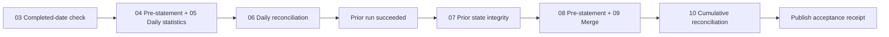

# SQL Design and Templates

Use this reference after the scope check. Verify sources and fields through [source discovery](source-discovery.md).

## Step 1: Design mergeable state

Daily tables hold state for D; cumulative tables hold snapshots through the end of D. Mergeable metrics usually have one row per subject and date; retain finer grain when required.

| Metric | State and merge rule |
|---|---|
| Numeric sum or count | Keep sums and event counts; add each separately. Count original rows. |
| First/last time or extrema | Keep candidates and ordering keys; define NULL and tie rules. |
| Property at first/last occurrence | Keep the property, time, and stable ordering key; select the complete record under the tie rule. |
| Average | Merge sum and valid count, then divide. |
| Distinct or rolling window | Keep sets, time buckets, or necessary detail and expire state correctly. |

The 13 templates implement cumulative SUM using `daily_amount`, `total_amount`, and `event_count`. Bind actual amount/duration columns and types. Other aggregates require adapted state, workflow nodes, and reconciliation.

Preserve an all-NULL SUM as NULL, and preserve real zeros and negative values. Inherit original types, precision, and tolerance. Templates cover subjects with target events. For subjects without events, add eligibility rows and define NULL, zero, and count behavior. Keep eligibility timing and necessary state; apply exact temporal relationships. Rebuild from the earliest affected day when eligibility or historical data changes.

## Step 2: Bind verified parameters

Name and create target tables and workflows automatically. Replace template `{{...}}` bindings with verified metadata; retain `${...}` platform runtime parameters. Quote identifiers, literals, and expressions according to the engine.

| Binding | Meaning |
|---|---|
| `{{DAILY_TABLE}}`, `{{STATE_TABLE}}` | Current writable targets; use fully qualified PROD references for consumption and read-only reconciliation. |
| `{{ACCEPTANCE_TABLE}}` | Separate workflow-owned table with `user_count BIGINT` and `stat_date VARCHAR`, partitioned by `stat_date`. Do not expose it to consumers or include it in snapshot cleanup. |
| `{{EVENT_TABLE}}` | Exact source reference established in the analysis project, adapted through a verified mapping, and readable in DataOps. |
| `{{USER_ID}}`, `{{EVENT_NAME}}`, `{{PART_DATE}}`, `{{AMOUNT}}` | Subject, event, partition, and numeric columns; double-quote special identifiers. |
| `{{USER_ID_TYPE}}`, `{{AMOUNT_TYPE}}` | Subject and state types, compatible with SUM precision. |
| `{{TARGET_EVENT_LITERALS}}` | SQL literal list of target events. |
| `{{BUSINESS_TIME_EXPR}}` | Time expression verified against the original date basis. |
| `{{HISTORY_START_TS}}` | Historical start in YYYY-MM-DD HH:mm:ss; templates already supply quotes. |
| `{{HISTORY_PART_START}}` | Earliest physical partition required to cover the start. |
| `{{SCAN_BACK_DAYS}}`, `{{SCAN_FORWARD_DAYS}}` | Nonnegative scan offsets justified by partition semantics, time differences, and arrival delay. |

| Runtime parameter | Derivation and check |
|---|---|
| `bd` | Target processing date; verify the configured offset and actual run expansion. |
| `tag_tz_name` | Original tag time zone for completed-day checks and required conversion. |
| `tag_tz_offset` | Original tag offset when the expression requires a fixed offset. |

Retain fixed-offset semantics where defined. For regional time zones, verify daylight-saving and per-event conversion. Adapt DATE, TIMESTAMP, and VARCHAR to actual types.

## Step 3: Align dates and physical partitions

If the original range includes today, process completed days ending yesterday and explain the adaptation in design and delivery. Derive all other dates, windows, historical starts, and filters from the saved definition.

| Original date basis | Handling |
|---|---|
| Event-local time | Preserve the original local calendar or conversion and verify day boundaries. |
| UTC event time | Convert into the original tag's time zone. |
| Time already in the target zone | Filter the target range directly. |
| Partition or defined business date | Use the original date field and date ownership. |

Templates use `business_time` as a SQL alias for the original date basis, not as a mandatory source field. Filter `D midnight <= business_time < D+1 midnight`. A date field may be projected to midnight TIMESTAMP; adapt daily statistics, initialization, and independent reconciliation consistently.

Apply pruning directly to the partition column. Cover every physical partition that can contain target-day data and distinguish event-day from arrival-day partitioning. Verify with boundary-crossing samples and query plans. A completed calendar day does not establish source arrival completeness; use a watermark or observed arrival evidence.

## Step 4: Wire gated workflow nodes

Initialization: `03 completed-date check -> 08 pre-statement + 11 baseline -> 12 independent full reconciliation + failure assertion -> publish acceptance receipt`.

Every edge is a successful dependency. Execute 04 and 08 inside their corresponding write nodes after upstream gates pass. Prior-run success requires platform execution or equivalent evidence. Template 07 also requires exactly one D-1 acceptance receipt and compares its recorded subject count with the current D-1 snapshot before 08 can run.

After 12 (initialization) or 10 (daily processing) succeeds, publish one receipt for the accepted date using `INSERT INTO {{ACCEPTANCE_TABLE}} SELECT COUNT(*), '${bd}' FROM {{STATE_TABLE}} WHERE stat_date='${bd}'`. Serialize acceptance and partition writes; before rewriting an accepted snapshot, invalidate its old receipt by deleting only its date from the acceptance table, after upstream gates pass but before 08. Verify publication before reporting run success. Never reconstruct a missing receipt from an unchecked snapshot: reconcile and accept the snapshot again first. This check detects lost rows, not same-count substitutions or value changes; use independent reconciliation for those.

| Templates | Purpose |
|---|---|
| 01, 02 | Date-partitioned table structures. |
| 03 | Reject an unfinished D before cleanup. |
| 04 + 05, 06 | Rebuild D statistics and compare each subject against detail. |
| 07 | D-1 structure and accepted subject count; missing or duplicate receipts fail closed. |
| 08 + 09, 10 | Rebuild cumulative state from D-1 and D, then compare each subject. |
| 08 + 11, 12 | Historical baseline and independent full-history differences. |
| 13 | Native yesterday-parameter consumption. |

Prefer platform-native assertions. Templates use `1/IF(condition,1,0)` to fail by division by zero; verify engine behavior. Templates 07 and 10 assume nonempty cumulative state. Adapt row-count assertions for a legitimate empty baseline or cumulative result and check source data and success status. Template 12 returns differences; add a failure assertion to gate later nodes.

Limit DELETE to D. Verify failure visibility, reruns, and refresh controls for DELETE plus INSERT. Treat atomic replacement as available only after platform validation.

## Step 5: Configure the native yesterday parameter

Use the UI's Add time parameter / Yesterday controls. Save and read back `name=date1`, `type=part_date`, and `recent_day=1-1`. `assets/tag-yesterday-parameter.json` is a minimal example; use the actual saved time zone and full configuration.

Template 13 fits a parameter contract referencing both `$part_date` and `@vpc_tz_#event_time`: project the snapshot date and its midnight timestamp, then use `${PartDate:date1}`. Verify fields, subject, time zone, expanded date, schedule, and actual results. A missing target partition produces an empty query result; apply the confirmed empty-update or skip-refresh policy.

## Step 6: Measure and maintain

Record elapsed time and engine metrics separately for daily aggregation, validation, prior-state reads, and snapshot writes. Compare equal scopes using equal measurements. For full-history differences, inspect dates, time zones, subjects, duplicates, history cleanup, corrections, and late arrivals. Once historical-retention rules are established, follow [validation and recovery](validation-and-recovery.md) and propagate repairs forward.
